# Manual del administrador

Usted es el único que puede **aprobar**, **corregir** y **firmar**. Tres cosas
que nadie más en el sistema puede hacer, y que son justamente las que mueven
plata.

Este manual asume que ya conoce el itinerario y las demás pantallas; si no,
el **Manual de coordinación** las explica. Aquí está lo que es solo suyo.

---

## 1 · Solicitudes: lo primero del día

**Lo que la coordinación cambia no se aplica.** Queda guardado, esperando a
que usted lo apruebe. Hasta entonces, la programación sigue como estaba y el
conductor no ve nada nuevo.

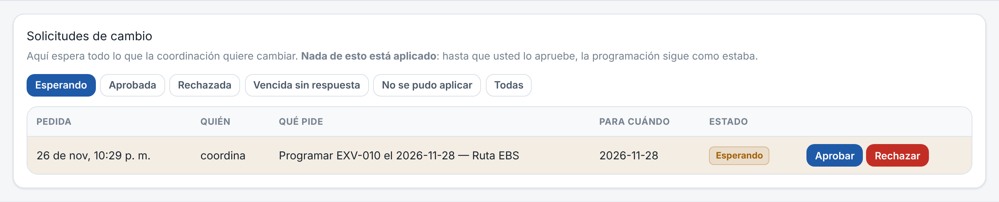

El número rojo del menú dice cuántas esperan. Cada línea dice en castellano
qué se pide, quién lo pide, para qué fecha sirve y en qué estado va.

### Aprobar

Ejecuta de verdad lo que se pidió, **con los permisos de quien lo pidió**. El
cambio queda firmado por la coordinación —fue su decisión— y la autorización
queda firmada por usted. Las dos cosas constan por separado en la auditoría.

> **Aprobar puede fallar, y es normal.** Entre que se pidió y usted contesta,
> el día pudo llenarse de viajes o la programación pudo desaparecer. En ese
> caso la solicitud queda **«No se pudo aplicar»** con el motivo exacto: ni
> aprobada, ni perdida, ni aplicada a medias.

### Rechazar

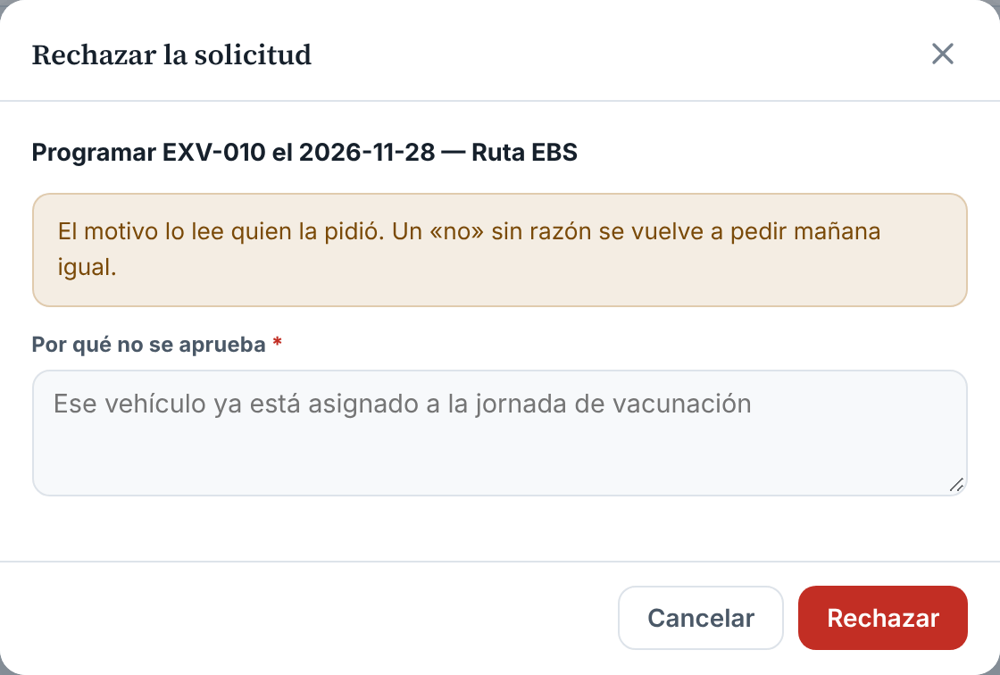

El motivo es **obligatorio** y lo lee quien lo pidió. Un «no» sin razón se
vuelve a pedir mañana igual.

### Lo que se vence

Una solicitud para el 25 que sigue sin respuesta el 26 ya no se puede aplicar:
pasa sola a **«Vencida sin respuesta»**. **No se borra.** Queda el rastro de
que se pidió y no se contestó — que es justo lo que a usted le conviene poder
demostrar.

> **Si usted no mira esta bandeja, no hay programación.** Ese es el precio de
> que nada se aplique solo. Mírela al empezar el día.

### Quién no pide permiso

**Usted** (si tuviera que aprobarse a sí mismo, nadie podría desatascar nada) y
**el conductor**: sus marcas de campo —salida, llegada, fotografía, checklist,
reportar una novedad o su propio vehículo varado— registran un hecho que ya
ocurrió, no una decisión sobre lo que se va a pagar.

---

## 2 · Viajes

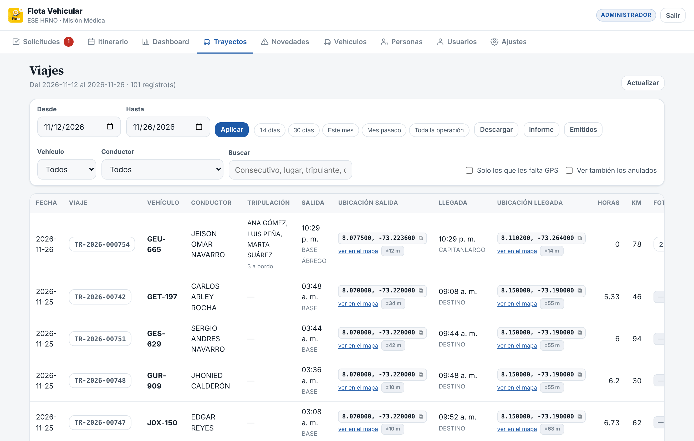

Además de lo que ve la coordinación, usted tiene **Ver también los anulados**,
y puede corregir, anular y restaurar.

### Corregir un viaje

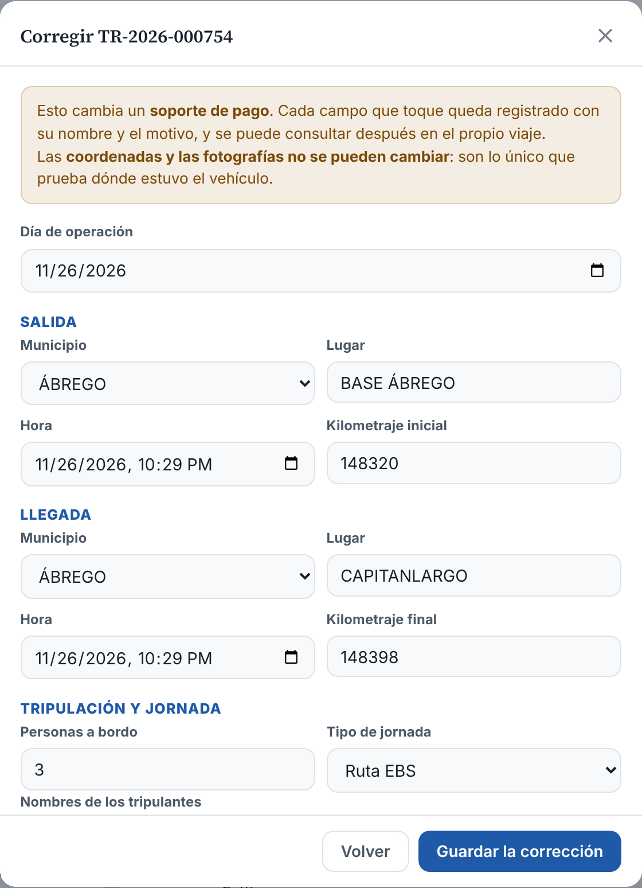

Se pueden corregir la **fecha de operación**, los **municipios y lugares**, las
**horas**, el **kilometraje**, la **tripulación**, el tipo de jornada y las
observaciones.

**No se pueden corregir** las coordenadas, la precisión del GPS, las
fotografías ni el estado. Eso es a propósito: son la prueba de dónde y cuándo
estuvo el vehículo, y un soporte que se puede reescribir no es un soporte.

- El **motivo es obligatorio**.
- Cada campo que cambia queda en el **historial del propio viaje**, con quién
  lo cambió y cuándo. No solo en la auditoría: ahí, al lado del dato.
- Si mueve la **fecha**, se recalculan **los dos días**, el de antes y el de
  después. La aplicación se lo advierte.

### Anular y borrar

**Anular** deja el registro, con su motivo, y se puede deshacer con
**Restaurar**. El viaje deja de contar para el pago pero no desaparece.

**Borrar definitivamente** elimina de verdad, con sus fotografías y su
checklist. Úselo solo para datos de prueba.

---

## 3 · El informe estadístico firmado

Un informe que alguien firma no es una descarga: es un **documento**. Por eso
se **emite**, con su radicado, y queda guardado.

### Emitir

Desde **Viajes**, botón **Informe**.

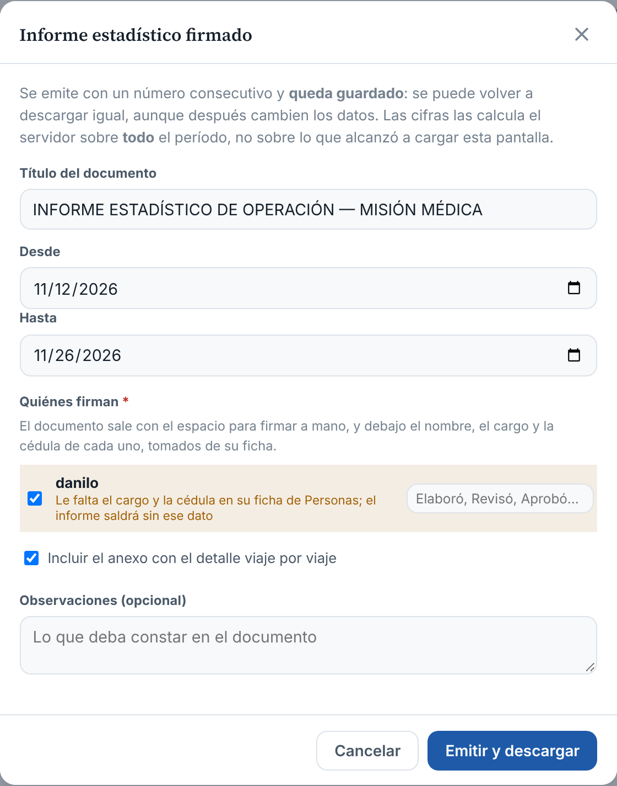

- El período viene del que tenga puesto en la pantalla, pero puede cambiarlo.
  Si tiene un filtro de vehículo o de conductor, el informe **solo habla de
  ese**, y se lo advierte.
- **Las cifras las calcula el servidor** sobre todo el período, no sobre lo que
  la pantalla alcanzó a cargar.
- **Los firmantes** se escogen de la lista de administradores. El nombre, el
  cargo y la cédula se leen de su **ficha de Personas**: si a alguien le falta
  alguno, la fila sale resaltada en ámbar **antes** de emitir.
- Cada firmante puede llevar su rótulo: *Elaboró*, *Revisó*, *Aprobó*.

El PDF trae: resumen de la operación · por vehículo · por conductor ·
**calidad del registro** · viajes por municipio · observaciones · firmas ·
y el anexo viaje por viaje.

La **calidad del registro** no se omite nunca: cuántas salidas y llegadas sin
GPS y sin fotografía, cuántos viajes sin cerrar, cuántas marcas se tomaron sin
señal y cuántos viajes se anularon. Un período con la mitad de los viajes sin
coordenadas no sostiene una liquidación, y el papel tiene que decirlo.

### Las cifras quedan congeladas

Lo que se emitió **no cambia nunca**. Si mañana se anula un viaje de ese
período, el informe sigue diciendo lo que decía el día que se firmó. Así el PDF
que está en la carpeta y el que sale hoy de la aplicación son el mismo papel.

### Reemitir

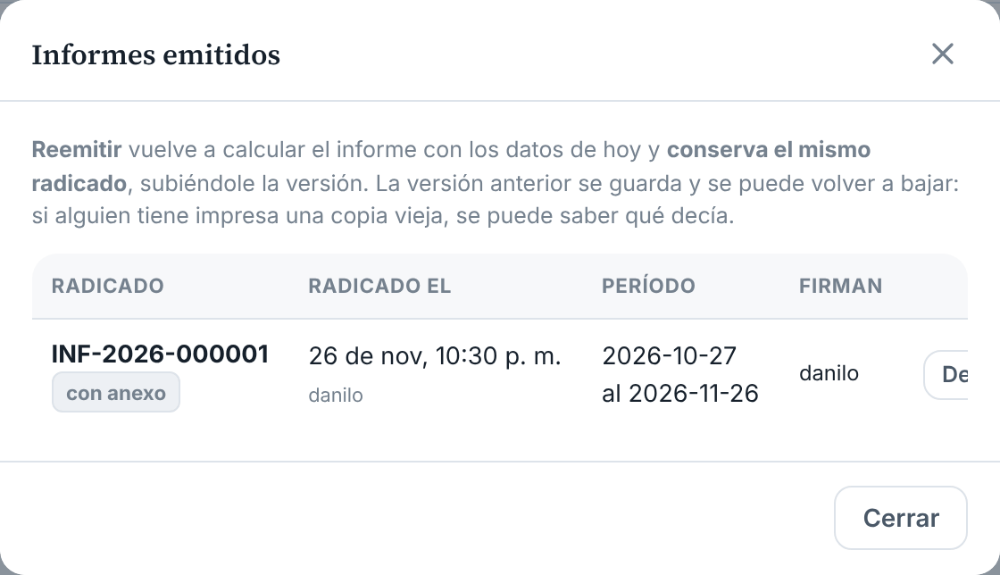

Cuando el informe **ya se radicó** —el número está en el libro, o ya se mandó
al contratista— y después se corrigió un viaje, pedir un radicado nuevo
obligaría a radicar otra vez.

**Reemitir conserva el radicado** y vuelve a calcular con los datos de hoy.

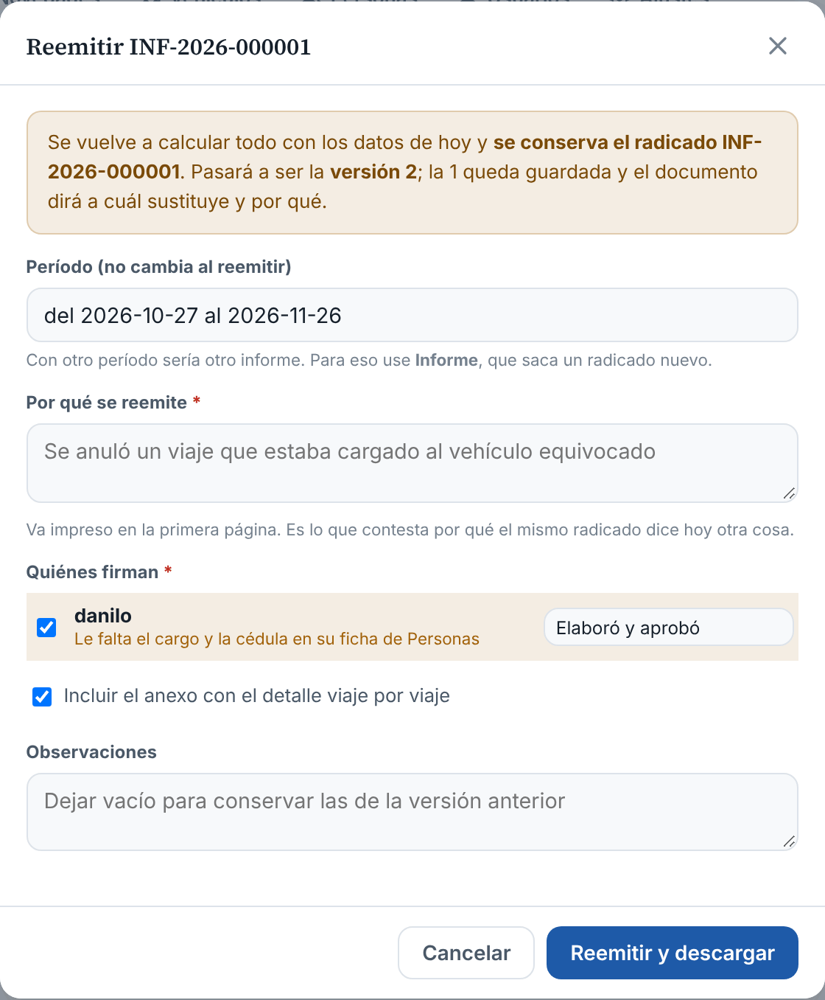

- El informe pasa a la **versión 2**, 3, y así.
- La versión anterior **se guarda entera** y se puede volver a bajar.
- El documento vigente trae una **franja ámbar**: *«REEMPLAZA a la versión 1 —
  si tiene impresa una copia anterior, deséchela — Motivo: …»*.
- La versión sustituida trae una **franja roja**: *«VERSIÓN SUSTITUIDA — ya no
  está vigente»*.
- **El motivo es obligatorio** y va impreso. Es lo único que contesta por qué
  el mismo radicado dice hoy otra cosa.
- **El período no se puede cambiar.** Con otro período sería otro informe, y
  reutilizarle el radicado sería esconder uno nuevo dentro de uno viejo.

---

## 4 · Dashboard

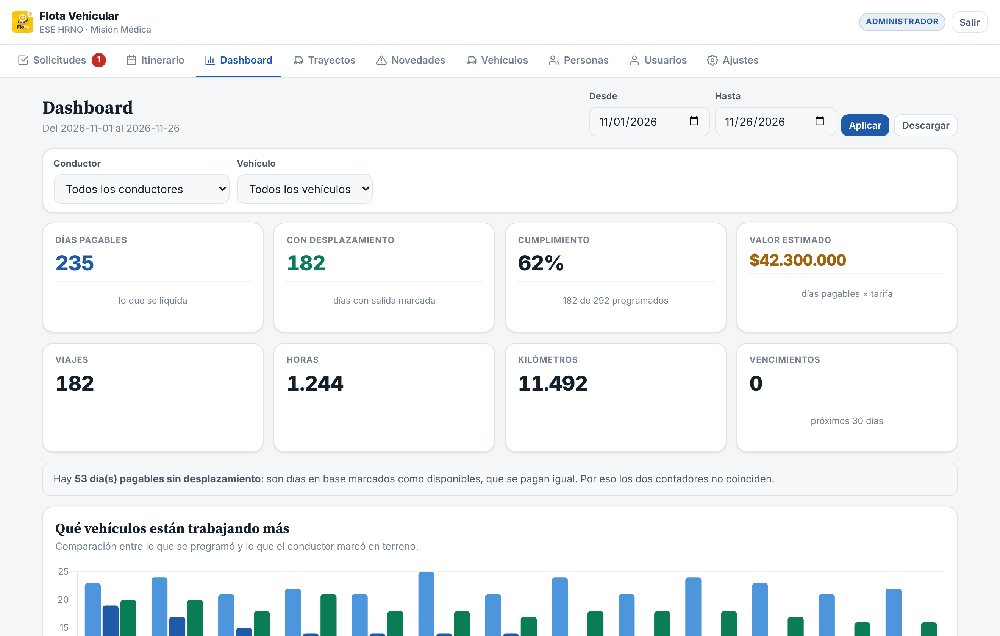

Los números de la operación. Los dos selectores de arriba **enfocan todo el
tablero** en un conductor o en un vehículo: no recortan la tabla, vuelven a
calcular.

**Días con desplazamiento** y **días pagables** no son lo mismo: un día
*Disponible en base* se paga igual. Con un solo número, el vehículo
subutilizado sería invisible.

---

## 5 · Vehículos

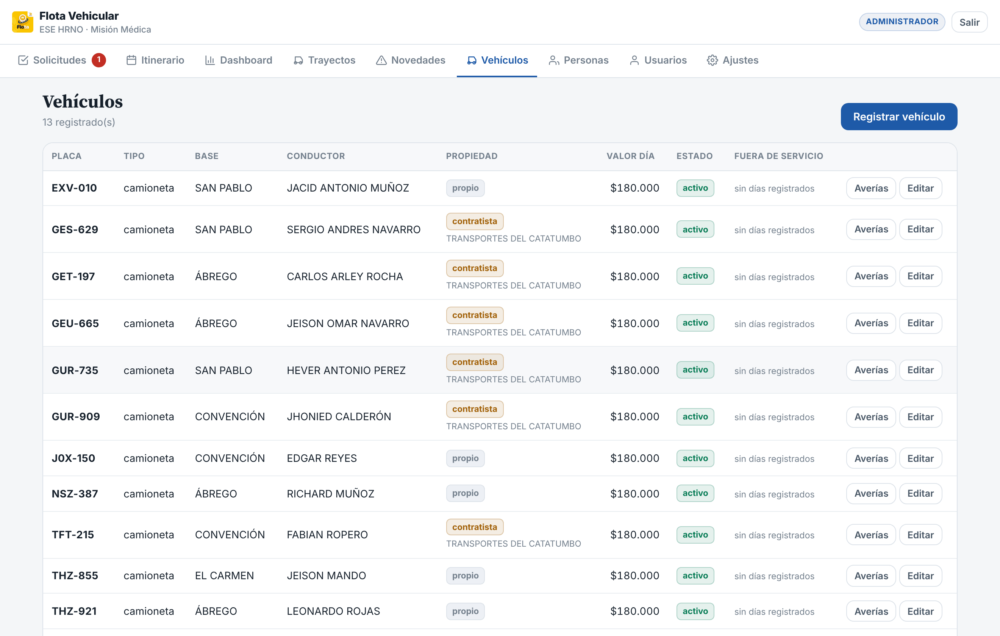

Placa, tipo, propiedad —propio o de contratista—, **valor día**, kilometraje,
conductor predeterminado y documentos con su vencimiento.

El **valor día** es lo que multiplica los días pagables en el informe.
Revíselo: un vehículo sin tarifa sale en cero, y uno con la tarifa equivocada
sale mal en un documento firmado.

### Averías

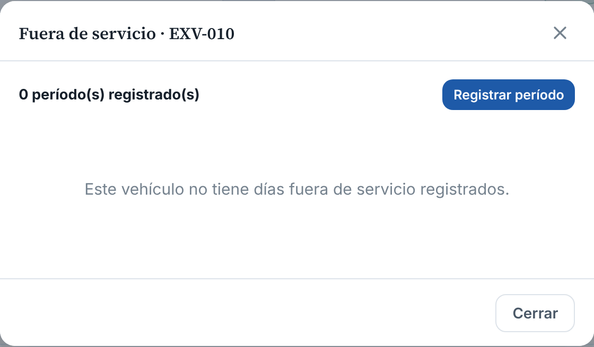

El historial de días fuera de servicio del vehículo, venga de donde venga: de
la coordinación o reportado por el propio conductor desde la vía.

Un período abierto —sin fecha de regreso— hace que **cada día que pasa deje de
ser pagable**. Ciérrelo cuando el vehículo vuelva a operar.

---

## 6 · Personas

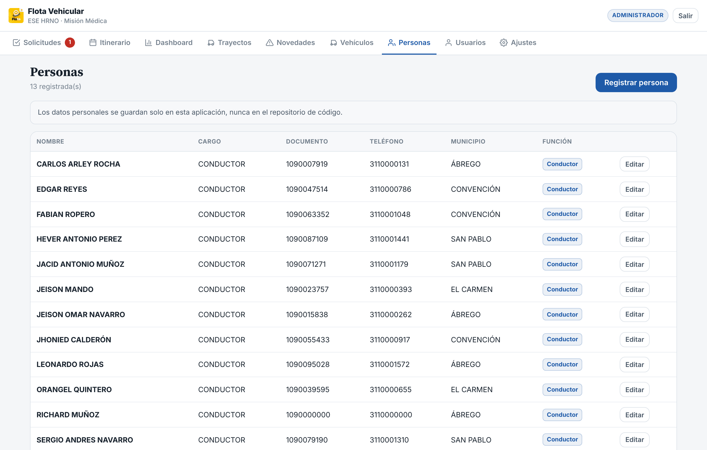

Son dos cosas distintas, y conviene no confundirlas:

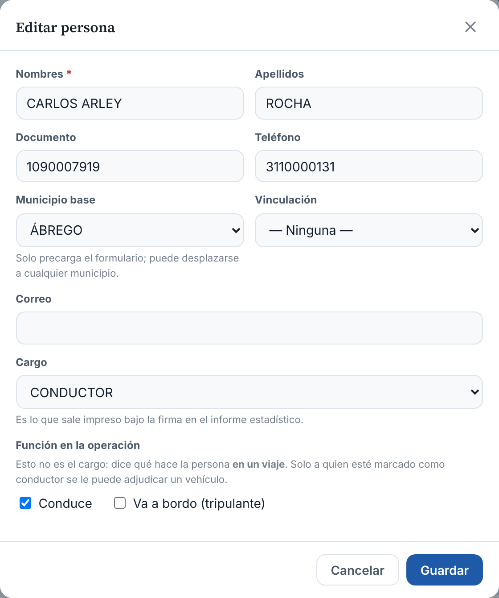

| | |
|---|---|
| **Cargo** | Lo que la persona **es** en la institución. Uno solo. Es lo que se imprime bajo la firma del informe |
| **Función en la operación** | Lo que hace **en un viaje**: conduce, va a bordo. Son casillas porque puede ser las dos. Solo a quien conduce se le puede adjudicar un vehículo |

La lista de cargos queda abierta con **Otro**: un hospital tiene más cargos de
los que quepan en una lista.

> **Si usted va a firmar informes, su propia ficha tiene que estar completa**
> —cargo y cédula— y vinculada a su usuario. Si no, la firma sale con el nombre
> de usuario y nada debajo, que no es una firma.

---

## 7 · Usuarios

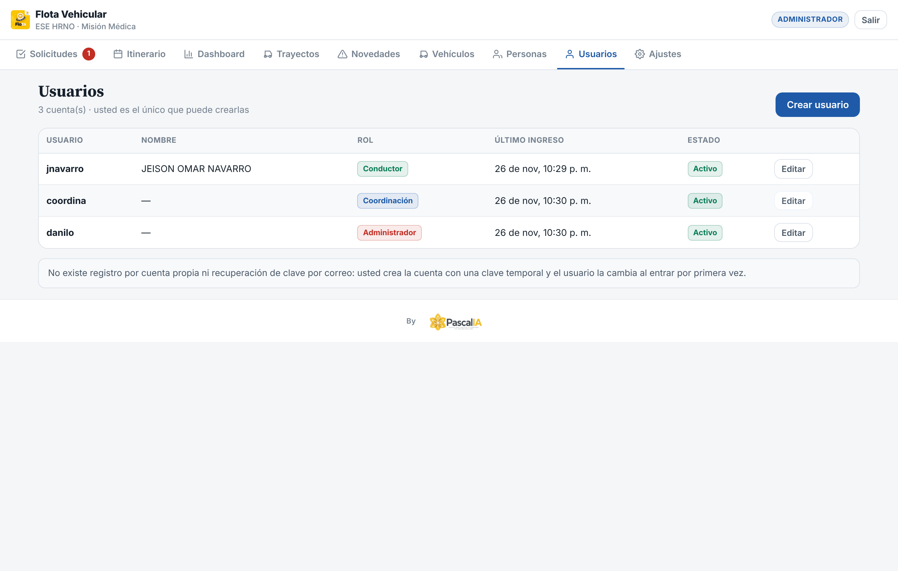

Usted es el único que crea cuentas. No hay registro por cuenta propia ni
recuperación de clave por correo: usted la crea con una **clave temporal** y el
sistema le exige cambiarla al entrar.

| Rol | Qué puede |
|---|---|
| **Conductor** | Marcar salida y llegada, reportar novedades y averías, ver su itinerario |
| **Coordinación** | Ve todo, programa el itinerario — y todo lo que cambia pasa por su aprobación |
| **Administrador** | Control total: aprobar, corregir, firmar, crear usuarios |

- Para un **conductor**, la persona vinculada es **obligatoria**: es lo que
  conecta la cuenta con su itinerario. Sin ella entra pero no ve nada.
- Para un **administrador** es técnicamente opcional, pero sin ella **no puede
  firmar**.
- El sistema **no deja desactivar al último administrador**.

> **Revise esta lista cada tanto.** Una cuenta de coordinación puede programar
> el itinerario, y el itinerario es el soporte de lo que se paga. Quien no
> deba tener ese rol, no debe tenerlo.

---

## 8 · Ajustes

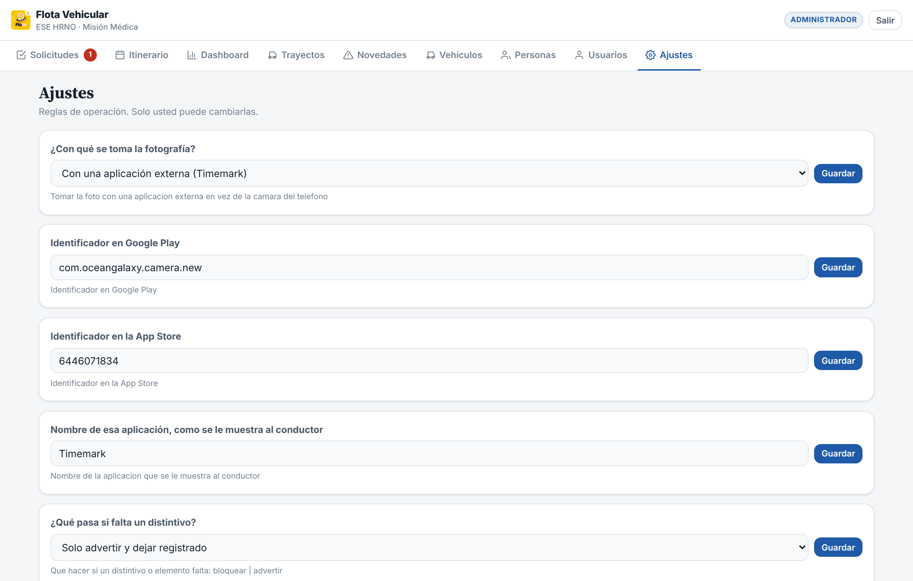

Las reglas de operación. Solo usted puede cambiarlas, y cambian el
comportamiento para todo el mundo.

| Ajuste | Qué decide |
|---|---|
| ¿Un día disponible en base se paga? | **Afecta directamente la liquidación** |
| ¿Exigir ubicación al marcar? | Si se puede marcar sin GPS |
| Precisión máxima aceptada | Por encima de eso, la marca queda señalada como dudosa |
| ¿Exigir fotografía al salir y al llegar? | |
| ¿Con qué se toma la fotografía? | Timemark o la cámara del teléfono |
| Nombre e identificadores de esa aplicación | Lo que se le muestra y se le abre al conductor |
| ¿Qué pasa si falta un distintivo? | Advertir o impedir la salida |
| Avisar vencimientos con esta anticipación | El semáforo de documentos |
| Diferencia tolerada con el soporte firmado | |
| Correos para las alertas | |

También desde aquí se sube el **banner institucional**, que sale en el ingreso,
en el encabezado y en el PDF del itinerario. Tamaño ideal **2000 × 289 px**.

---

## 9 · Auditoría

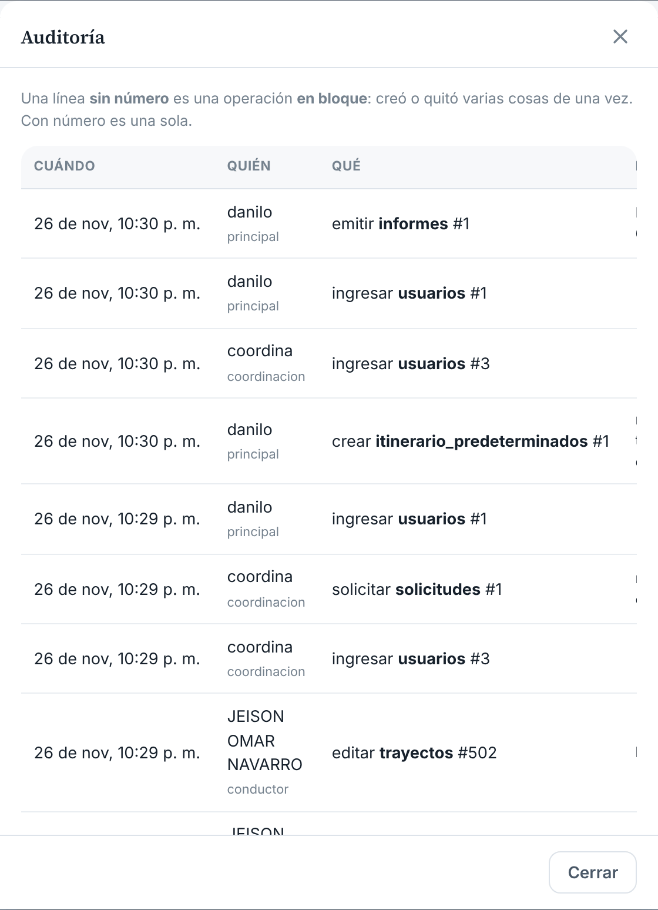

Quién hizo qué y cuándo. **No se puede modificar ni borrar**, por nadie.

Lo que hay que saber para leerla:

- Una línea **con número de ficha** es **una** cosa: una programación, un
  viaje, un usuario.
- Una línea **sin número** es una operación **en bloque**: creó o quitó varias
  de una vez. Van **resaltadas en ámbar** con la etiqueta *en bloque*.
- La columna **Detalle** traduce lo que pasó a lenguaje corriente: *«3 creadas
  de un golpe»*, *«plantilla de Excel»*, el motivo entre comillas, los campos
  que cambiaron.

Esa diferencia entre «con número» y «sin número» es la que contesta la pregunta
que de verdad importa cuando aparece programación que nadie pidió: **quién, y
de cuántas a la vez.**

---

## Rutina sugerida

**Cada día**

1. **Solicitudes** — resuelva lo que espera. Si no lo hace, no hay programación.
2. **Viajes** del día anterior — mire los que quedaron abiertos y los que les
   falta GPS.
3. **Novedades** — lo que reportaron los conductores.

**Cada semana**

4. **Dashboard** — compare vehículos y conductores.
5. **Vehículos** — documentos por vencer y períodos de avería sin cerrar.

**Cada mes**

6. **Informe firmado** del mes cerrado, con los firmantes que correspondan.
7. **Auditoría** — una pasada por lo que se hizo en bloque.
