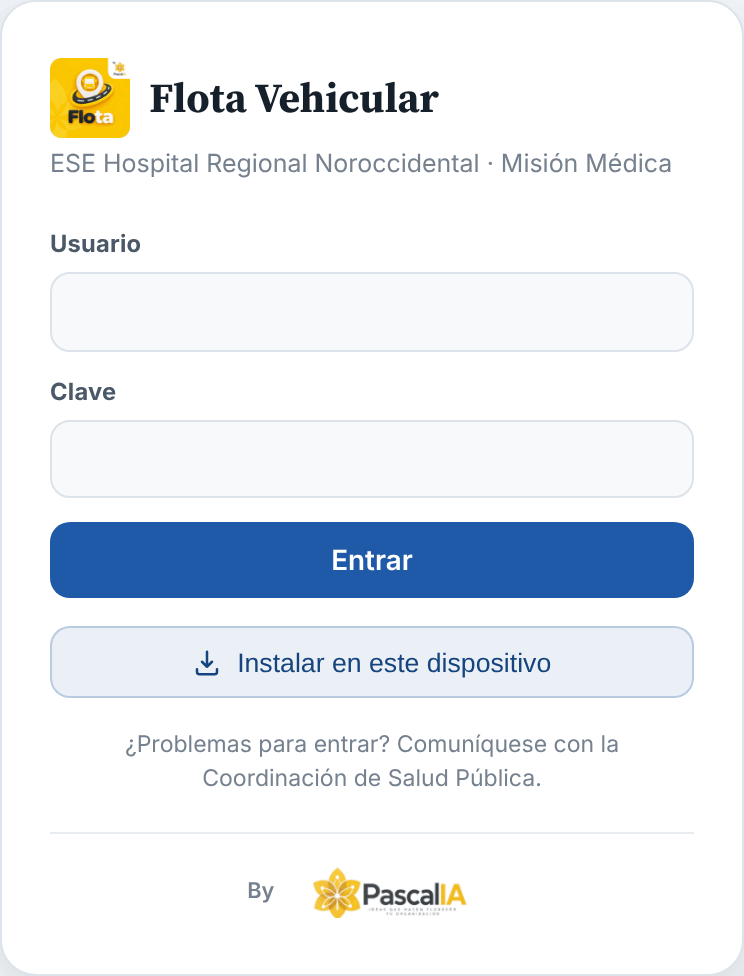
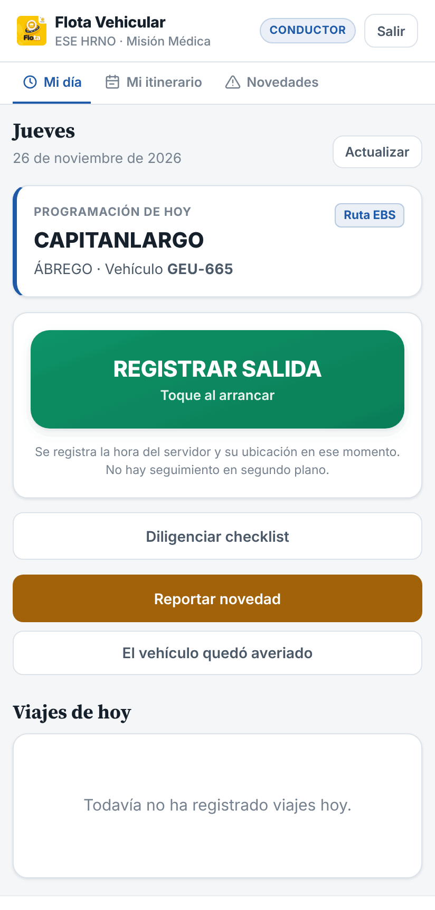
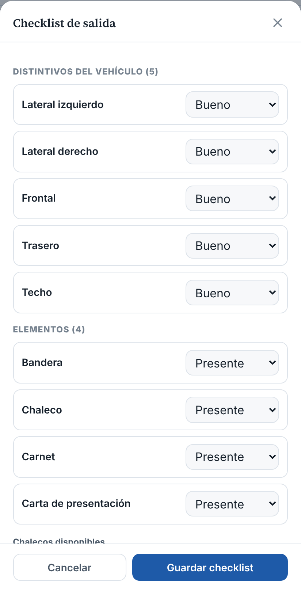
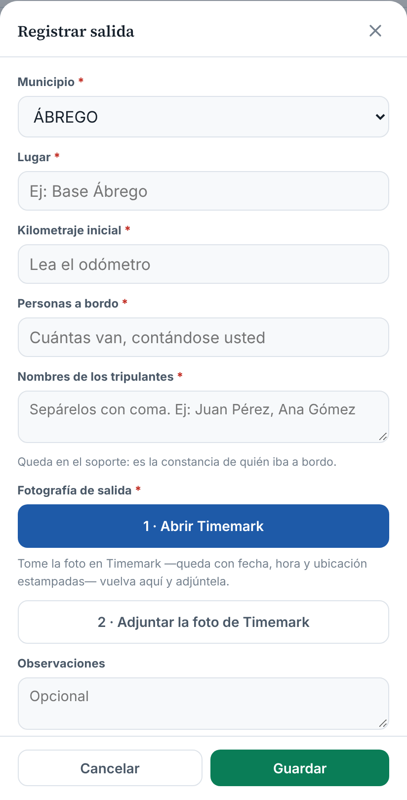
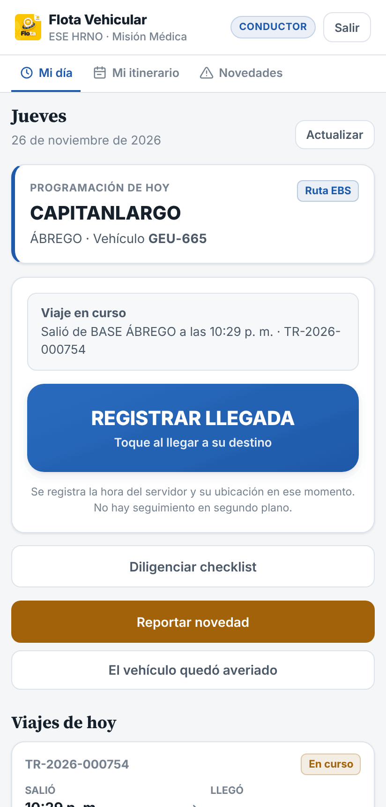
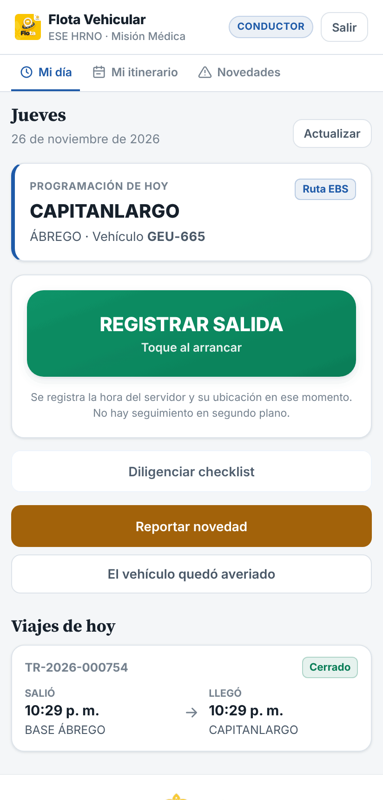
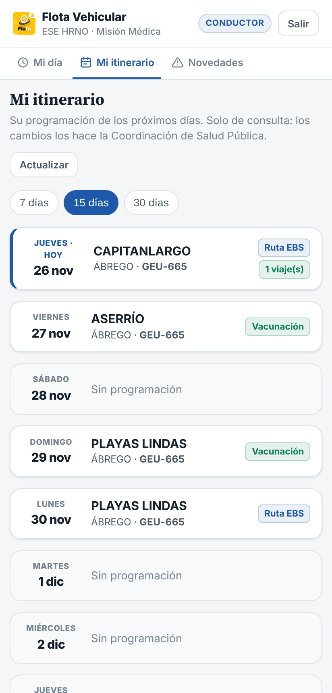
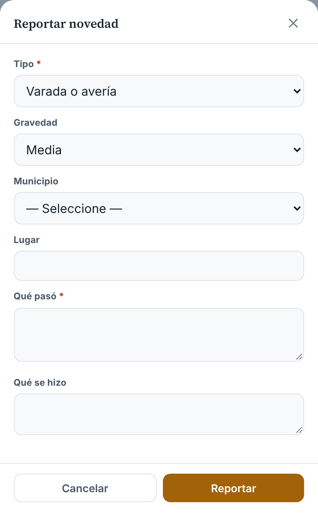
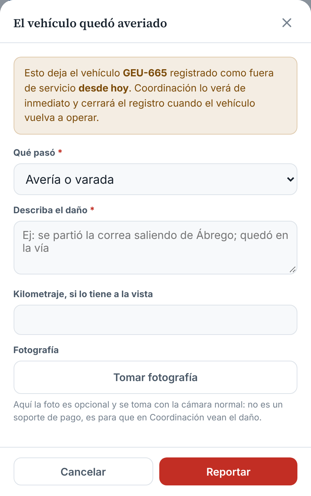

# Manual del conductor

Esta aplicación reemplaza la planilla de papel. Usted hace **dos cosas al día**:
marcar cuando **sale** y marcar cuando **llega**. Nada más.

De esas dos marcas sale el soporte de lo que se paga por el vehículo, así que
lo que usted registre es lo que se cobra. Por eso la aplicación pide la
fotografía y la ubicación: no para vigilarlo, sino para que el día quede
probado sin que nadie tenga que creerle a nadie.

> **No lleva seguimiento en segundo plano.** La aplicación toma su ubicación
> **solo en el momento** en que usted toca «Registrar salida» o «Registrar
> llegada». Entre una marca y otra no sabe dónde está, y cuando está cerrada
> no hace nada.

---

## 1 · Instalarla en el celular

No está en Play Store ni en App Store. Se instala desde el navegador y pesa
casi nada.

1. Abra la dirección que le pasó la Coordinación, o apunte la cámara al código
   QR que le enviaron.
2. **Android:** salga el aviso de «Instalar aplicación», tóquelo. Si no sale,
   abra el menú de los tres puntos y busque *Instalar aplicación* o *Agregar a
   pantalla principal*.
3. **iPhone:** toque el botón de compartir (el cuadrito con la flecha hacia
   arriba) y luego *Agregar a inicio*.

Le queda el icono amarillo de **Flota** en el escritorio del celular. Ábralo
desde ahí: se ve a pantalla completa, sin la barra de direcciones, y funciona
aunque se quede sin señal.

---

## 2 · Entrar

Su usuario y su clave se los entrega la Coordinación. La primera vez que entre,
la aplicación le va a **exigir que cambie la clave** por una suya.

- El usuario se escribe **sin mayúsculas y sin espacios**.
- Si se le olvida la clave, **no hay recuperación por correo**: llame a la
  Coordinación y le generan una nueva.
- No tiene que volver a entrar cada día. La sesión queda abierta.

---

## 3 · Mi día

Es la pantalla con la que va a trabajar todos los días.

Arriba sale **la programación de hoy**: a dónde va, con qué vehículo y de qué
tipo es la jornada. Si dice *Sin programación*, hable con la Coordinación antes
de salir.

Debajo están los botones del día:

| Botón | Para qué |
|---|---|
| **REGISTRAR SALIDA** | Tóquelo **al arrancar**, no antes |
| **Diligenciar checklist** | Revisión del vehículo antes de salir |
| **Reportar novedad** | Algo pasó: un retraso, un problema en la vía, lo que sea |
| **El vehículo quedó averiado** | El vehículo no puede seguir operando |

---

## 4 · El checklist, antes de arrancar

Revise los **cinco distintivos** de Misión Médica del vehículo y los **cuatro
elementos** que debe llevar. Marque lo que encuentre tal como esté: si falta
algo, dígalo. El checklist sirve para que la Coordinación sepa qué hay que
reponer, no para ponerle problema a usted.

---

## 5 · Registrar la salida

Toque **REGISTRAR SALIDA** en el momento en que arranca.

Llene lo que pide:

- **Municipio y lugar** — de dónde arranca.
- **Kilometraje inicial** — léalo del odómetro, no lo calcule.
- **Personas a bordo** — cuántas van, **contándose usted**.
- **Nombres de los tripulantes** — separados por coma. Esto queda en el
  soporte: es la constancia de quién iba.
- **Fotografía de salida** — obligatoria.

### La fotografía, con Timemark

La foto **no se toma con la cámara normal**. Va en dos pasos:

1. Toque **1 · Abrir Timemark**. Se abre la otra aplicación, tome la foto allá.
   Queda con la fecha, la hora y la ubicación estampadas encima.
2. Vuelva a Flota y toque **2 · Adjuntar la foto de Timemark**.

Esa estampa es la que hace que la foto sirva de soporte. Una foto de la cámara
normal no la tiene.

> **La hora la pone el servidor, no su celular.** Aunque su teléfono tenga la
> hora corrida, la marca queda con la hora correcta. No intente «ajustarla»
> cambiando la hora del celular: no sirve de nada y sí deja un registro raro.

---

## 6 · Durante el viaje

El viaje queda **En curso** y el botón cambia a **REGISTRAR LLEGADA**. Puede
cerrar la aplicación tranquilo; el viaje sigue abierto.

---

## 7 · Registrar la llegada

Al llegar a su destino, toque **REGISTRAR LLEGADA**. Pide lo mismo: municipio,
lugar, **kilometraje final** y la fotografía de llegada.

El viaje queda **Cerrado** y con eso el día queda soportado. Si en el mismo día
hace otro desplazamiento, vuelva a registrar salida: puede haber varios viajes
en un día.

> **Un viaje que se le quedó abierto no cuenta como cerrado.** Si se le olvidó
> marcar la llegada, avísele a la Coordinación el mismo día. Usted no puede
> corregir una marca ya hecha —eso es a propósito, es un soporte de pago—, pero
> el administrador sí puede arreglarla.

---

## 8 · Mi itinerario

Su programación de los próximos días: a dónde le toca y con qué vehículo. Es
**solo de consulta**; los cambios los hace la Coordinación.

Revísela el día anterior. Si ve algo que no cuadra, es mejor resolverlo la
noche antes que a las seis de la mañana.

---

## 9 · Reportar una novedad

Una novedad es cualquier cosa que valga la pena dejar escrita: un retraso, una
vía cerrada, un problema con el usuario, un trancón, lo que sea.

Reportar mucho **no es malo**. Al contrario: el que reporta es el que deja
claro por qué el día fue como fue.

---

## 10 · Si el vehículo se le vara

Toque **El vehículo quedó averiado** y describa el daño. Quedará registrado
como fuera de servicio **desde hoy**, y la Coordinación lo ve de inmediato.

- La fecha de regreso **no se la piden**: usted no la sabe todavía.
- La fotografía aquí **es opcional** y se toma con la cámara normal: no es un
  soporte de pago, es para que en Coordinación vean el daño.
- El período lo cierra la Coordinación cuando el vehículo vuelva a operar.

---

## 11 · Cuando no hay señal

**La aplicación abre y funciona sin señal.** Esto está hecho a propósito,
porque en buena parte de la zona no hay cobertura.

Lo que pasa cuando marca sin señal:

1. La marca se guarda **en el celular**, con su fotografía.
2. Arriba le sale un aviso de que hay marcas sin enviar.
3. **Apenas vuelva la señal, se envían solas.** No tiene que hacer nada.

> **No borre la aplicación ni los datos del navegador si tiene marcas sin
> enviar:** se pierden. Espere a que el aviso desaparezca.

La hora que queda registrada es la del servidor cuando la marca llega, pero
también se guarda la del celular en el momento real. Si hay diferencia de más
de diez minutos, el sistema lo señala solo, y la Coordinación sabe que fue una
marca tomada sin señal.

---

## 12 · Si bloqueó la ubicación por error

Si al entrar la primera vez le tocó «Bloquear» en el permiso de ubicación, la
aplicación se lo avisa y le ofrece un botón para arreglarlo.

Si el botón no funciona, hágalo a mano:

- **Android (Chrome):** los tres puntos → *Información del sitio* → *Permisos*
  → *Ubicación* → **Permitir**.
- **iPhone (Safari):** Ajustes → Safari → *Ubicación* → **Preguntar** o
  **Permitir**.

**La marca se guarda igual, aunque no haya ubicación**, pero queda señalada
como «sin GPS» y eso es un reparo en la cuenta. Mejor arreglarlo.

---

## Reglas de oro

1. **Marque al arrancar y al llegar**, no cuando se acuerde.
2. **Lea el odómetro**, no lo calcule de memoria.
3. **La foto va con Timemark**, siempre.
4. **Sin señal también se marca.** Se envía sola después.
5. **Un viaje abierto no cuenta.** Si se le olvidó cerrarlo, avise el mismo día.
6. **Reportar una novedad nunca es un problema.** Callarla sí.

---

## ¿Problemas?

Comuníquese con la **Coordinación de Salud Pública** de la ESE Hospital
Regional Noroccidental.
