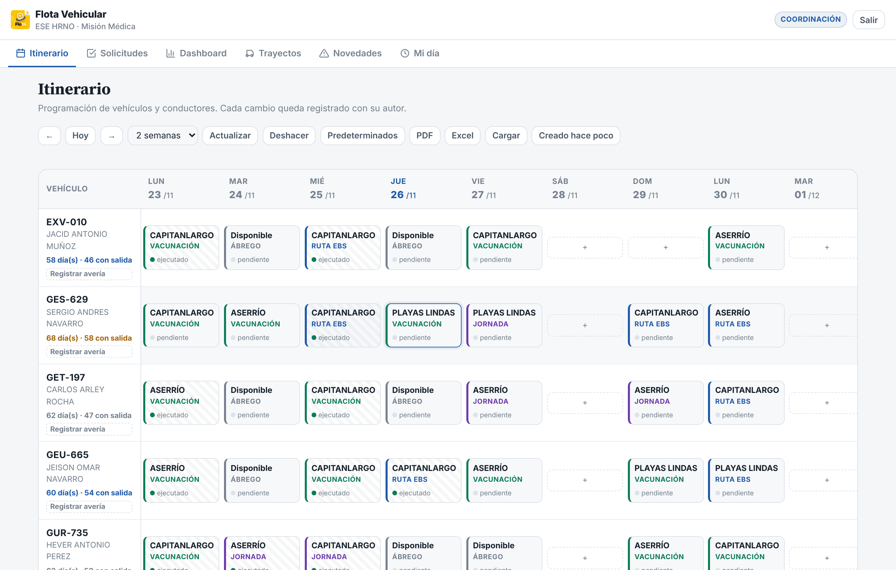
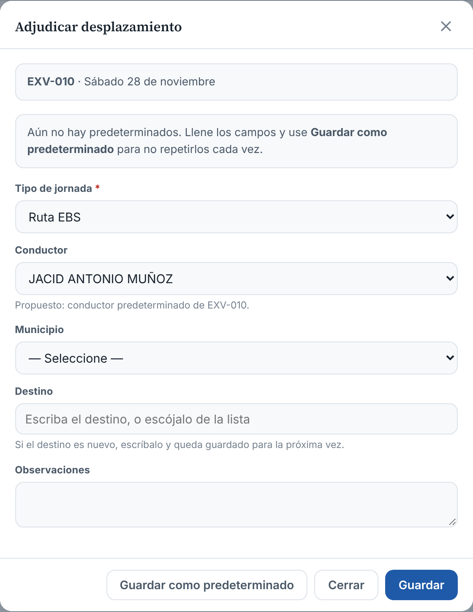
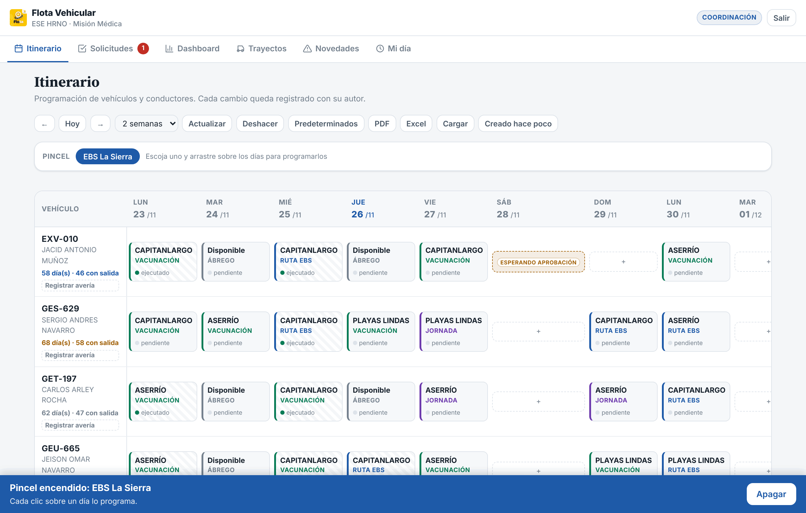
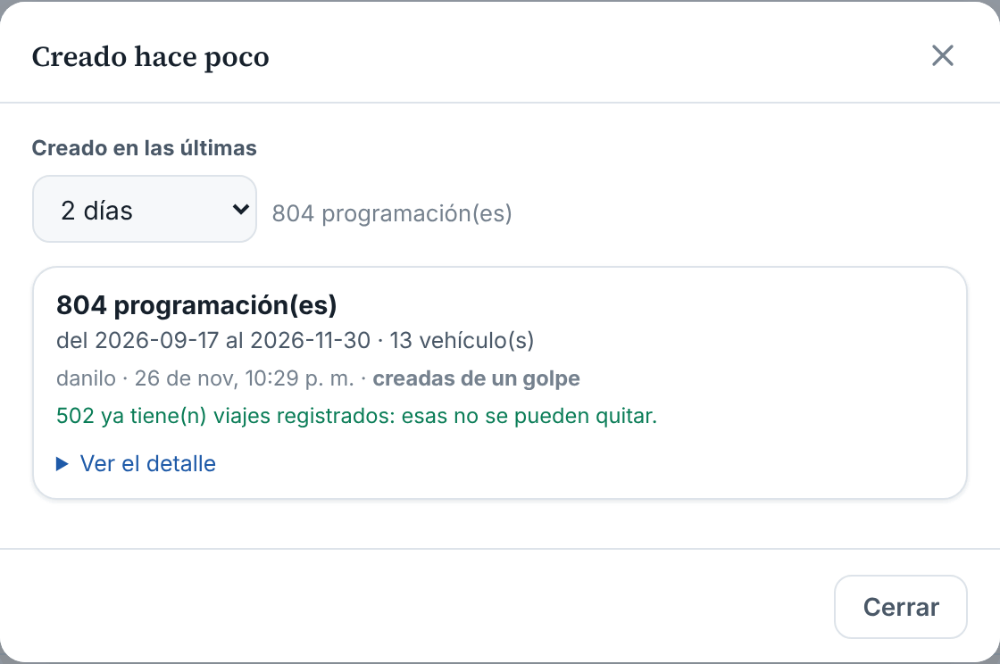
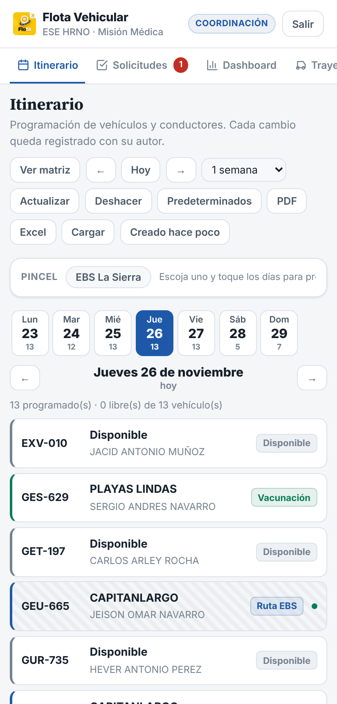
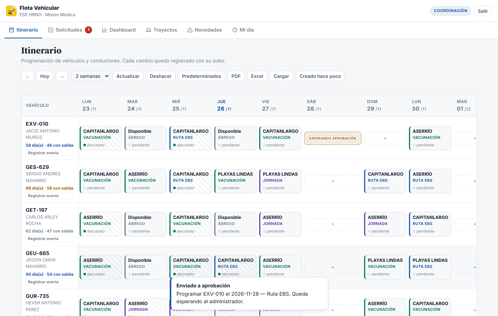
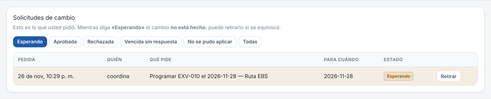
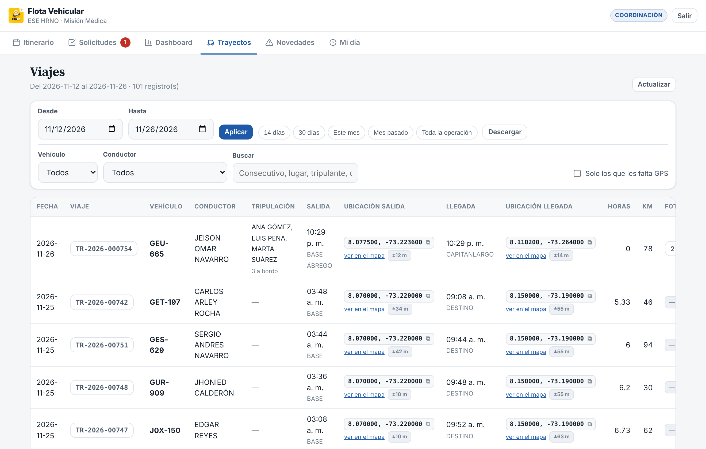
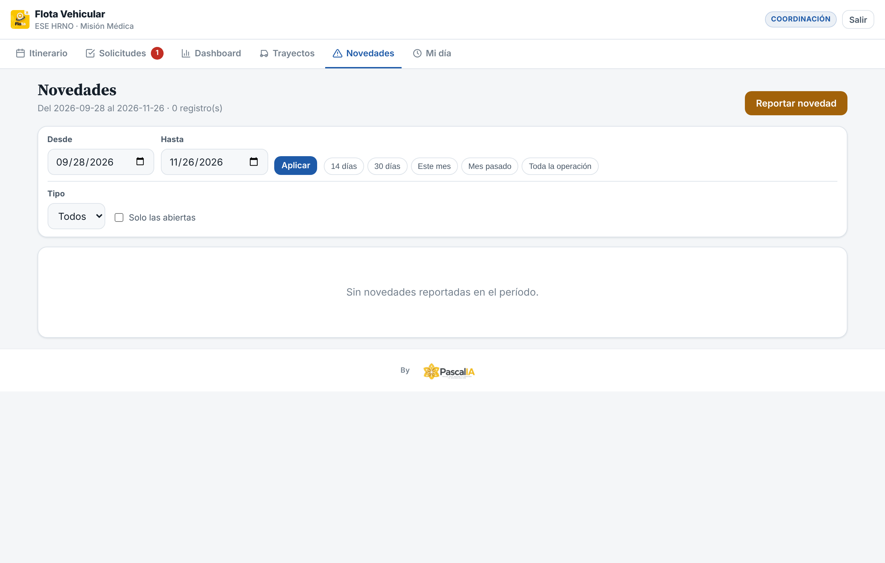
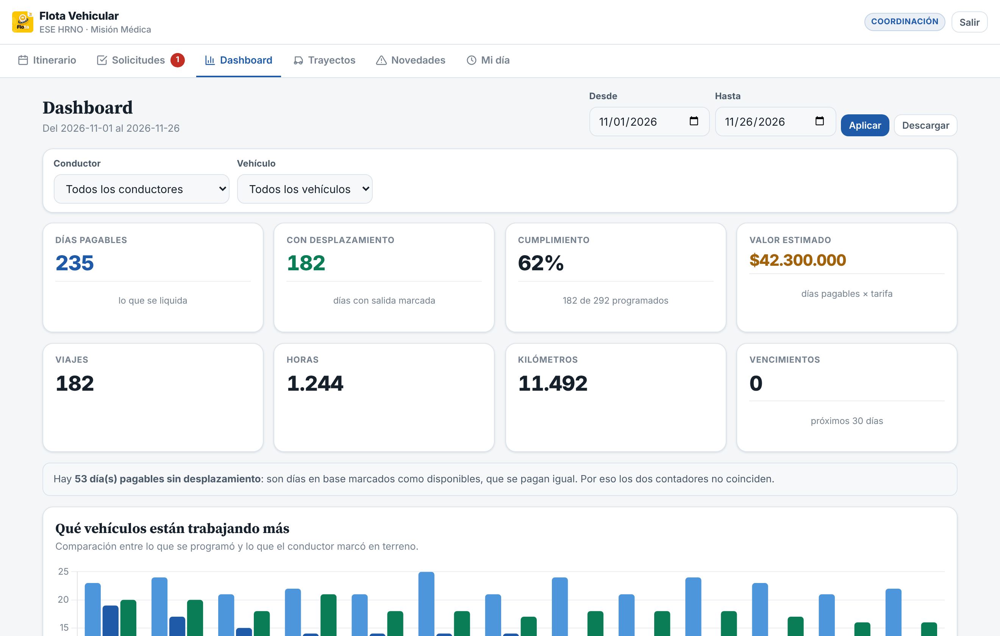

# Manual de coordinación

Su trabajo en la aplicación es **programar**: decir qué vehículo va a dónde y
con quién, cada día. Esa programación es la base de lo que después se paga, así
que todo lo que usted escriba queda registrado con su nombre y con la hora.

> **Lo que usted cambia no se aplica solo.** Desde hace poco, cada cambio que
> usted hace en la programación **queda esperando al administrador**. Él
> aprueba o rechaza. Está explicado en la sección 6, y conviene leerla antes
> que nada: cambia la forma de trabajar.

---

## 1 · El itinerario

Es su pantalla principal. Una matriz: **los vehículos en las filas y los días
en las columnas**.

Cada casilla es un día de un vehículo:

| Lo que ve | Qué significa |
|---|---|
| Casilla con destino y color | Ese día está programado. El color es el tipo de jornada |
| Casilla con **+** | Ese día está libre |
| `ejecutado` con punto verde | El conductor ya marcó salida ese día |
| `pendiente` | Programado, pero el conductor todavía no ha marcado |
| Casilla **rayada en gris** | Ese día está cerrado: ya tiene viajes y no se puede mover |
| Etiqueta roja **fuera de servicio** | El vehículo está parado ese día |

A la izquierda de cada fila, bajo la placa, va la cuenta de **toda la
operación** —no solo del período que está viendo— y el botón **Registrar
avería**.

### Moverse por el calendario

Los botones de arriba: **←** y **→** mueven el período, **Hoy** vuelve a la
semana en curso, y el desplegable cambia el largo (1 semana, 2 semanas, 1 mes).

---

## 2 · Programar un día

Toque una casilla con **+**.

- **Tipo de jornada** — Ruta EBS, Jornada, Vacunación, Disponible, Fuera del
  área o Administrativo. *Disponible* es el vehículo en base: **se paga igual**
  que un día con desplazamiento, por eso existe como tipo propio.
- **Conductor** — viene propuesto el predeterminado del vehículo. Puede
  cambiarlo.
- **Municipio** y **destino** — el destino se **escribe**; si es nuevo, queda
  guardado en la lista para la próxima vez. No hay que crearlo antes en ningún
  catálogo.

El municipio base del conductor **no lo restringe**: puede mandarlo a donde sea.

### Guardar como predeterminado

Si va a repetir mucho esa combinación, use **Guardar como predeterminado**. Le
queda una ficha arriba de la matriz, lista para usarla con el pincel.

---

## 3 · Programar muchos días de una vez

### El pincel

Toque una ficha de predeterminado y queda **encendido**. A partir de ahí,
**cada día que toque queda programado** con ese predeterminado, sin ventanas de
por medio. Con el ratón puede arrastrar sobre varios días seguidos.

Mientras esté encendido sale una **barra fija abajo** con el nombre del
predeterminado, la cuenta de lo que lleva hecho y un botón **Apagar**. Esa
barra está ahí por una razón: con el pincel encendido cada toque programa, y en
un teléfono no hay cursor que se lo recuerde.

> **Apáguelo cuando termine.** Un pincel que se queda encendido sigue
> programando a cada toque.

### Mover y duplicar

Arrastre una casilla a otro día o a otro vehículo para **moverla**. Con
**Ctrl** presionado, la **duplica**. Si la suelta sobre una casilla ocupada,
las dos **se intercambian**.

No se puede mover ni duplicar sobre un día que ya tenga viajes registrados: la
marca del conductor quedaría apuntando a una programación que ya no describe lo
que hizo.

El botón **Deshacer** revierte el último arrastre.

### La plantilla de Excel

**Excel** le descarga el período visible como una hoja de cálculo, con listas
desplegables en cada celda. La llena, y con **Cargar** la vuelve a subir: la
aplicación le muestra **primero** todo lo que va a cambiar, y solo se aplica
cuando usted confirma.

### Creado hace poco

Lista lo que se programó en las últimas 24 horas, 48 horas, 7 o 30 días,
**agrupado por momento y por autor**: cuántas, entre qué fechas y quién.

Sirve para dos cosas: revisar lo que acaba de cargar, y darse cuenta de
programación que nadie esperaba. Los días que ya tienen viajes registrados
**no se pueden quitar** y la ventana se lo dice.

---

## 4 · Desde el teléfono

La matriz completa no cabe en una pantalla de celular. Use **Ver por día**.

Se escoge el día en la tira de arriba y debajo salen **todos los vehículos**:
los programados con su destino y los libres como una ranura que se toca para
adjudicar. Se programa igual que en la matriz.

La aplicación recuerda cuál de las dos vistas dejó puesta.

---

## 5 · Registrar un vehículo averiado

Desde la columna de placas del itinerario, botón **Registrar avería**.

Se registra el **período** en que el vehículo estuvo parado y la causa: avería,
mantenimiento, accidente, documentos, retenido, sin conductor u otro.

Un día fuera de servicio **no es pagable**, salvo que ese día tenga viajes
cerrados: si el vehículo salió, el hecho manda sobre el registro.

Si dentro del período hay días ya programados, la aplicación **le ofrece
cancelarlos**, pero no lo hace por su cuenta: puede haber un relevo con otro
vehículo que usted todavía no ha adjudicado.

---

## 6 · Las solicitudes de aprobación

**Esto es lo que más cambió.** Lo que usted hace en el itinerario ya no se
aplica solo: se guarda y espera al administrador.

### Qué pide aprobación

| Pide aprobación | No pide |
|---|---|
| Programar, cambiar, borrar o mover un día | Consultar cualquier pantalla |
| La carga desde la plantilla de Excel | Descargar informes o archivos |
| Crear o cambiar un predeterminado | Registrar una novedad nueva |
| Editar una novedad ya registrada | |
| Registrar o cambiar un período fuera de servicio | |
| Crear un destino nuevo | |

### Cómo se ve

Al guardar, el aviso dice **«Enviado a aprobación»**, no «Guardado». Y la
casilla queda **rayada en ámbar** con la etiqueta *esperando aprobación*.

- Un día que ya tiene una solicitud **no admite otra**. Si toca la casilla, la
  aplicación le recuerda qué se pidió.
- Mientras diga *esperando*, **el cambio no está hecho**: el conductor no ve
  esa programación.

### Su bandeja

En **Solicitudes** ve lo que usted pidió y en qué va. El número rojo del menú
le dice cuántas están esperando.

- **Retirar** — si se equivocó al pedir, quítela usted mismo sin esperar a que
  se la rechacen. El día vuelve a quedar libre para volver a pedirlo bien.
- Si se la **rechazan**, el motivo queda escrito ahí. Léalo antes de volver a
  pedir lo mismo.
- Una solicitud para un día que **ya pasó** se vence sola y queda registrada
  como *vencida sin respuesta*.

> **Pida con tiempo.** Una solicitud para el martes que se pide el martes a las
> seis de la mañana puede no alcanzar a aprobarse, y ese día no habrá
> programación.

---

## 7 · Viajes

Todo lo que los conductores han marcado. Arriba escoge el **período**: 14 días,
30 días, este mes, el mes pasado o **toda la operación**.

Puede filtrar por vehículo, por conductor, buscar por texto (consecutivo,
lugar, tripulante, observación) y aislar **los que les falta GPS**.

**Descargar** le baja en Excel exactamente lo que está viendo, con todas las
columnas —incluidas las que la tabla no muestra: kilometrajes, precisión del
GPS, hora del celular, observaciones—.

Al tocar un viaje se abre su ficha completa: horas, lugares, coordenadas,
fotografías y kilometraje.

---

## 8 · Novedades

Lo que reportan los conductores. Mismo selector de período que en Viajes, y se
pueden aislar **las que siguen abiertas**.

Usted puede **editar** una novedad para completarla o cerrarla — y eso, como
todo lo demás, pasa por aprobación.

---

## 9 · Dashboard

Los números de la operación en el período que escoja: días programados, días
con desplazamiento, **días pagables**, viajes, kilómetros y horas.

Dos cosas que conviene entender:

- **Días con desplazamiento** y **días pagables** no son lo mismo. Un día
  *Disponible en base* se paga igual aunque el vehículo no se haya movido. Por
  eso se cuentan aparte: con un solo número, el vehículo subutilizado sería
  invisible.
- Los dos selectores de arriba **enfocan todo el tablero** en un conductor o en
  un vehículo. No recortan la tabla: vuelven a calcular todo.

**Descargar** baja el detalle por vehículo en Excel.

---

## Resumen de la jornada

1. Revise el **itinerario** de los próximos días.
2. Programe lo que falte, con el pincel o uno por uno.
3. Mire su bandeja de **Solicitudes**: lo que pidió no está hecho hasta que lo
   aprueben.
4. Revise **Novedades** y **Viajes** del día anterior.
5. Registre las **averías** que le reporten.
